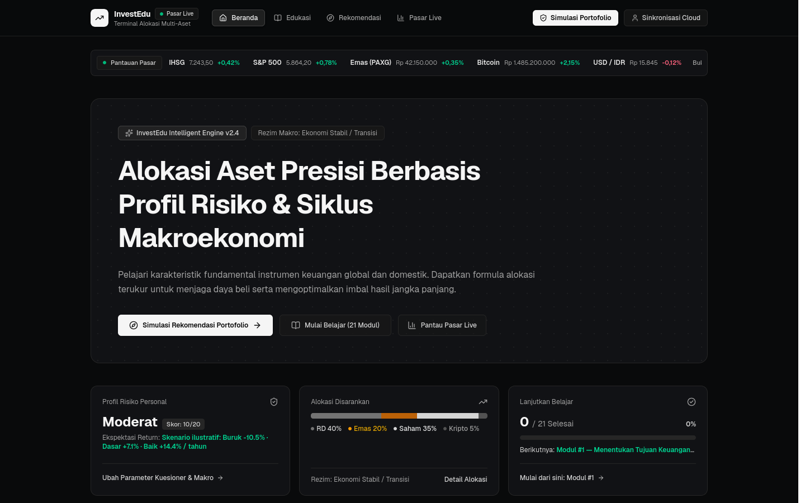
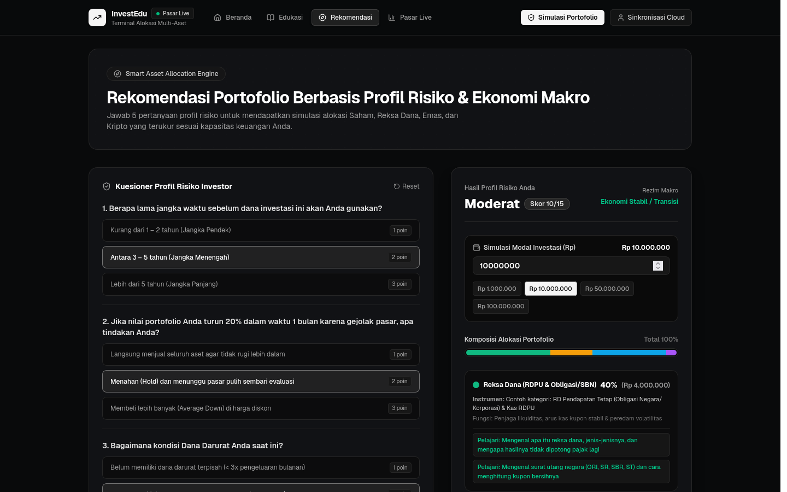

# InvestEdu — Edukasi & Simulasi Alokasi Investasi Multi-Aset

**InvestEdu** adalah aplikasi web edukasi finansial dan simulasi alokasi portofolio multi-aset (**Reksa Dana & SBN**, **Emas**, **Saham**, dan **Aset Kripto**) berbahasa Indonesia. Aplikasi ini dirancang untuk membantu masyarakat umum dan investor pemula memahami fondasi keuangan pribadi sebelum menempatkan dana ke instrumen pasar modal maupun aset digital.

---

## Untuk Siapa Aplikasi Ini?

- **Pemula yang baru ingin mulai berinvestasi**: Mempelajari urutan prioritas keuangan (dana darurat, inflasi vs bunga majemuk, dan cara mengenali investasi bodong/pinjol ilegal) melalui jalur belajar bertahap (**"Mulai dari sini"**).
- **Investor ritel yang ingin menyusun alokasi portofolio**: Mengukur kapasitas dan toleransi risiko secara terpisah melalui kuesioner 5 dimensi untuk mendapatkan simulasi pembagian aset beserta skenario hasil tahunan (buruk/dasar/baik) dan perkiraan penurunan terburuk dalam Rupiah.
- **Pelajar pasar keuangan**: Memantau perbandingan karakteristik instrumen, mencoba kalkulator DCA (investasi rutin), dan mempelajari grafik pasar maupun simulasi alarm harga.

---

## Batasan & Penafian Penting (Disclaimer)

1. **Alat Edukasi, Bukan Nasihat Investasi Berizin**: Seluruh materi, kuesioner profil risiko, dan simulasi alokasi portofolio di InvestEdu bersifat edukatif. Tidak ada bagian dari aplikasi ini yang merupakan ajakan jual/beli instrumen keuangan atau rekomendasi penasihat investasi berizin.
2. **Status Data Pasar (Live vs Contoh Statis)**:
   - Harga **Bitcoin (`BTC`)**, **Ethereum (`ETH`)**, **PAX Gold (`PAXG`)**, dan **Emas (`gold-idr`)** diambil dari API publik CoinGecko dengan cache memori 60 detik (dan fallback ke data statis jika API tidak terjangkau).
   - Data **IHSG (`ihsg`)**, **saham (`bbca`, `bbri`)**, **indeks RDPU (`rdpu-index`)**, serta **indikator makroekonomi** merupakan **data contoh statis** untuk keperluan ilustrasi edukasi dan diberi penanda status secara eksplisit di antarmuka.
   - Mode grafik **Candle (ilustrasi)** dan **Garis (ilustrasi)** pada modal terminal dibangkitkan secara deterministik dari sparkline, bukan riwayat transaksi bursa sesungguhnya.
3. **Alarm Harga Berbasis Tab Aktif**: Fitur alarm harga hanya mengevaluasi harga selama halaman `/market` terbuka di peramban (polling setiap 60 detik saat tab terlihat) dan tidak mengirim notifikasi latar belakang saat tab ditutup.

---

## Tangkapan Layar

### Beranda & Jalur Belajar


### Kuesioner Profil Risiko & Simulasi Alokasi Portofolio


---

## Persyaratan & Cara Menjalankan Secara Lokal

Proyek ini menggunakan **Bun** (`bun@1.4.4`) dan **Next.js 16 (App Router + Turbopack)**.

1. **Instal dependensi:**
   ```bash
   bun install
   ```

2. **Jalankan server pengembangan:**
   ```bash
   bun run dev
   ```

3. Buka [http://localhost:3000](http://localhost:3000) di peramban.

---

## Variabel Environment

Secara default aplikasi dapat langsung berjalan **tanpa file `.env`** karena penyimpanan lokal otomatis menggunakan SQLite/libSQL pada file `file:investedu.db` di direktori proyek.

Jika ingin menghubungkan ke database **Turso / libSQL** eksternal, buat file `.env.local` dengan variabel berikut:

```env
# Opsional — default ke "file:investedu.db" jika dikosongkan
TURSO_DATABASE_URL="libsql://nama-db-anda.turso.io"
TURSO_AUTH_TOKEN="token-turso-anda"
```

---

## Verifikasi & Pengecekan Kualitas Kode

Jalankan perintah berikut secara berurutan sebelum melakukan commit atau deploy:

1. **Typecheck TypeScript (`strict` mode):**
   ```bash
   npx tsc --noEmit
   ```
2. **Self-check & Unit Test (`node:assert/strict`):**
   ```bash
   bun src/lib/recommendation.test.ts
   ```
3. **Linter (ESLint Next.js Core Web Vitals + TypeScript):**
   ```bash
   bun run lint
   ```
4. **Production Build:**
   ```bash
   bun run build
   ```

---

## Struktur Halaman & Arsitektur Singkat

| Path | Deskripsi |
|---|---|
| `/` (`src/app/page.tsx`) | Beranda: pintasan jalur belajar ("Mulai dari sini" / "Lanjutkan belajar"), kalkulator simulasi DCA, dan ringkasan progres pengguna. |
| `/education` (`src/app/education/page.tsx`) | Kurikulum edukasi berurutan (21 modul dari kategori **Dasar**, **Reksa Dana**, **Emas**, **Saham**, hingga **Kripto**) lengkap dengan kuis interaktif dan daftar sumber referensi. |
| `/recommendation` (`src/app/recommendation/page.tsx`) | Kuesioner profil risiko (memisahkan kapasitas finansial vs toleransi psikologis), pagar pengaman dana darurat & horizon pendek, skenario imbal hasil buruk/dasar/baik, dan rincian alokasi Rupiah. |
| `/market` (`src/app/market/page.tsx`) | Pantauan pasar multi-aset dengan penanda status data (`Live` vs `Contoh statis`), terminal grafik (`TradingView (data asli)` & mode ilustrasi), serta alarm harga selama tab terbuka. |
| `/privasi` (`src/app/privasi/page.tsx`) | Kebijakan privasi, transparansi penyimpanan `localStorage` vs database akun, serta panduan penghapusan akun mandiri. |
| `/api/market` (`src/app/api/market/route.ts`) | Endpoint pasar dengan cache 60 detik (TTL 10 detik saat fallback) yang menggabungkan harga live CoinGecko ke `FALLBACK_ITEMS`. |
| `/api/auth` & `/api/user-state` | Autentikasi multi-pengguna (`scrypt` async, sesi cookie `httpOnly` dengan token ter-hash SHA-256, rate limit persisten di database, serta fitur hapus akun) dan sinkronisasi progres antar-perangkat. |
